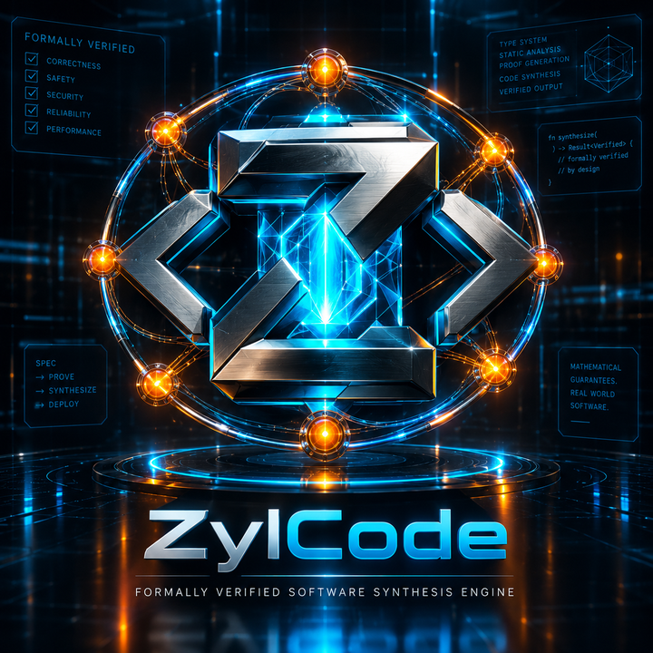
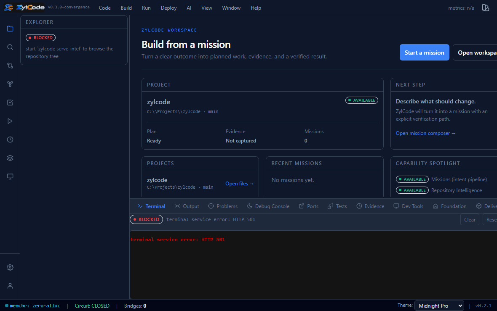
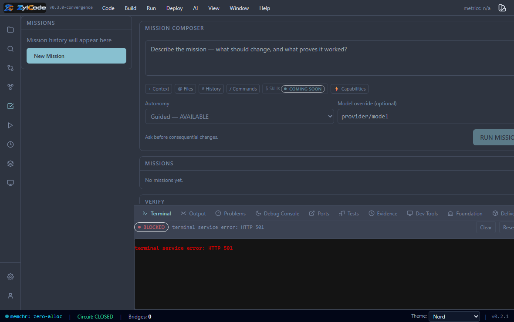
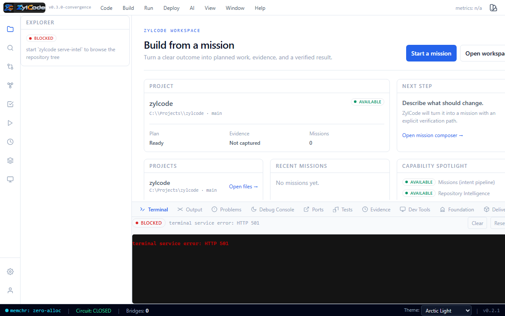
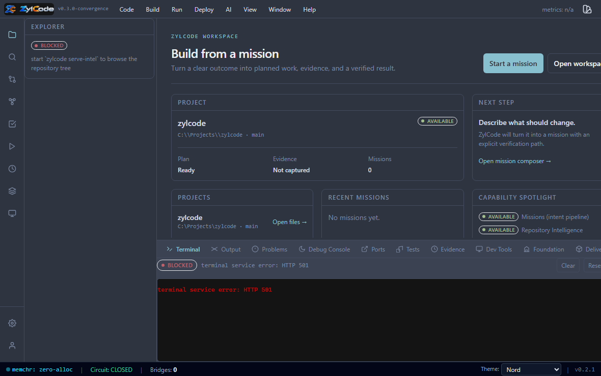

# ZylCode — Software Creation Operating System

<p align="center">
  
</p>

[](https://github.com/zylvex-tech/zylcode/actions/workflows/ci.yml)
[](LICENSE)

ZylCode is an engineering software platform developed by **Zylvex Technologies
Ltd.** It is intended to help transform ideas and instructions into
structured, executable, testable, and verifiable deliverables: plan the work,
execute it under human control, verify the result, and keep traceable evidence
for every technical claim along the way.

It is local-first and bring-your-own-key: you run the desktop application and
the CLI on your own machine, and model calls go through providers you
configure yourself (`docs/PROVIDERS.md`).

> **Early access:** join the [Developer Preview waitlist](https://site-0522a86bd09e48629a1e90f115711758.freebuff.page)
> — pre-release, free / invite-only. No pricing is published during public
> development (`docs/governance/ZYLCODE_COMMERCIAL_MODEL.md`).

---

## Product Preview

> **DEVELOPER PREVIEW** — the assets below are real captures of the ZylCode desktop
> frontend running in **browser preview** mode (no Tauri backend attached), so
> backend-driven panels show their honest `BLOCKED` state and a mission is *composed*,
> not run. Full capture record — starting commit, environment, redaction and
> publication checks — in
> [`docs/media/zylcode/README.md`](docs/media/zylcode/README.md).



**Live theming** — the whole shell re-themes on the fly, no reload:

<video src="docs/media/zylcode/preview-theming.mp4" width="760" controls preload="metadata">
  <a href="docs/media/zylcode/preview-theming.mp4">Download preview-theming.mp4</a>
</video>

**Panel and dock navigation** — the bottom panel dock and the right workspace:

<video src="docs/media/zylcode/preview-navigation.mp4" width="760" controls preload="metadata">
  <a href="docs/media/zylcode/preview-navigation.mp4">Download preview-navigation.mp4</a>
</video>

**Composing a mission** — the real Mission Composer, with real keystrokes:

<video src="docs/media/zylcode/preview-mission-composer.mp4" width="760" controls preload="metadata">
  <a href="docs/media/zylcode/preview-mission-composer.mp4">Download preview-mission-composer.mp4</a>
</video>

| Surface | Capture |
|---|---|
| Mission Composer |  |
| Light theme (Arctic Light) |  |
| Alternate theme (Nord) |  |

---

## Product Vision

The long-term direction is an environment that carries a change all the way
from intent to a verified artefact — a loop of **design → build → run →
inspect → verify → ship**, with evidence recorded at each step.

That direction is larger than what exists today. This README keeps three
categories strictly apart, and every capability claim below is placed in one
of them using repository evidence:

| Category | Meaning |
|---|---|
| **Implemented and tested** | The code exists on this branch, is reachable from a product surface, and its tests pass in CI and in local runs referenced below. |
| **Partially implemented** | Real code exists but is incomplete, disclosed as limited, or awaiting independent acceptance. |
| **Planned** | Documented intent only — not operational, not claimed as working. |

The authoritative, row-by-row capability ledger is
[`docs/capability-registry.json`](docs/capability-registry.json). Where that
registry records a capability as disputed, this README does not call it
verified: builders do not certify their own work
([`CONTRIBUTING.md`](CONTRIBUTING.md)).

---

## Current Architecture

```
zylcode/
├── apps/
│   ├── zylcode-desktop/        Tauri v2 + React desktop application
│   │   ├── src/                Panels: agent workspace, tool runner, repo
│   │   │                       navigation & intel, terminal, git, settings
│   │   └── src-tauri/          36 backend commands (process_intent,
│   │                           execute_tool, repo_context, nav_query,
│   │                           git_status, file_content, …)
│   └── natlas-sdk/             TypeScript SDK + zero-build playground for the
│                               N-ATLAS bridge (integration workstream)
├── crates/
│   ├── zylcode-core/           Agent loop, planning, provider routing,
│   │                           repository intelligence, factory runner,
│   │                           evidence ledger, terminal, crash recovery
│   ├── zylcode-mcp/            Tool registry, permission gate, evidence and
│   │                           telemetry, real file/git/shell/search executors
│   ├── zylcode-nav/            Repository scanner, symbol index, dependency
│   │                           graph, navigation query engine
│   └── zylcode-cli/            `zylcode` binary: repo-context, the serve-intel
│                               HTTP surface, missions, build helpers
├── docs/                       Architecture, governance, roadmap, evidence
└── .github/workflows/          CI (check, clippy, full test suite, build)
```

How the pieces relate:

* **User-facing application** — the desktop app drives the same core engine
  the CLI does, over two transports: Tauri IPC (36 commands; the UI currently
  invokes the agent journey, tool execution, repository context/navigation,
  git and file surfaces among them) and the loopback-only `zylcode
  serve-intel` HTTP service used by the browser preview.
* **Execution and verification** — tool calls run through the permission gate
  in `zylcode-mcp`; consequential operations require approval; results are
  verified and recorded in a hash-chained evidence store under `.zylcode/`.
* **Repository intelligence** — `zylcode-nav` and the core intelligence
  pipeline build a persisted index (files, symbols, dependencies) that feeds
  the agent's context, the `zylcode repo-context` CLI command, and the
  navigation/intel panels.
* **AI/model integration** — a provider router with full-chain failover sends
  requests to models you configure (API keys stay yours; no token markup).
  The N-ATLAS bridge (below) is one model integration among the platform's
  provider paths.

Planned modules that are **not** part of the current operational architecture
are tracked only in the roadmap (see *Project Status and Roadmap*).

---

## Core Engineering Principles

These principles are implemented in code and exercised by tests; each entry
states what is *verified* versus what remains a *design intention*.

* **Structured engineering workflows** — an instruction becomes a plan, then
  gated execution steps, then verification. *Verified:* the agent-loop and
  factory end-to-end suites (`agent_loop_e2e`, `factory_job_e2e`) run in CI.
* **Human approval before consequential operations** — tools carry risk
  classifications; approval-gated operations fail closed without a grant.
  *Verified:* approval-enforcement and permission-gate tests in the workspace
  suite. *Intention:* approval UX breadth beyond the current gate paths.
* **Controlled file modification and command execution** — file writes, shell
  and git operations go through real executors behind the permission gate,
  not ad-hoc side effects. *Verified:* executable-tool and fault-injection
  suites (`executable_tools_e2e`, `zylcode-mcp` fault-injection tests).
* **Testing and verification** — every change is checked by CI: workspace
  compile, `clippy -D warnings`, the full Rust test suite, the
  retracted-claim guard, and a frontend typecheck + build.
* **Traceable evidence for technical claims** — evidence records are
  hash-chained; a corrupted chain is an error, never a silent empty state.
  *Verified:* evidence/ledger tests in the core suite. *Intention:* treating
  this ledger as an independent, auditable attestation — acceptance is an
  auditor's verdict, not a builder's claim.
* **Explicit handling of model and runtime failures** — provider failover
  walks the whole configured chain before degrading offline; quota and
  transport failures are classified precisely and redacted before storage;
  crash recovery re-reads persisted state. *Verified:* router,
  `natlas_runtime`, `natlas_bridge`, and crash-recovery suites.

---

## Current Implementation Status

Everything in this section was re-verified on this branch head (`6469bae`)
rather than copied from older documents. See [`docs/PROJECT_MASTER_STATUS.md`](docs/PROJECT_MASTER_STATUS.md)
for the complete phase-by-phase project status.

### Evidence

| Check | When | Result |
|---|---|---|
| GitHub Actions CI on this commit — `cargo check --workspace --all-targets`, `cargo clippy … -D warnings`, `cargo test --workspace --all-targets`, retracted-claim guard, desktop typecheck + build | 2026-10-23 (run on PR #28 merge) | ✅ green (4 checks passed) |
| `cargo test -p zylcode-core` (lib + integration targets) | 2026-10-23, local run on this branch head | ✅ **503 passed, 0 failed** |
| `cargo test -p zylcode-mcp` (lib) | 2026-10-23, local run | ✅ **134 passed, 0 failed** |
| `pnpm install --frozen-lockfile` | 2026-10-23, local | ✅ exit 0 |
| `pnpm --filter zylcode-desktop build` (tsc + vite) | 2026-10-23, local | ✅ exit 0 |
| `cargo audit` | 2026-10-23, local | ✅ **0 vulnerabilities**, 2 accepted warnings |

The test suites include the agent-loop and factory end-to-end journeys,
property tests, crash-recovery tests, N-ATLAS bridge suites, and the
`serde-saphyr` regression tests — all green.

### Implemented and tested on this branch

* Desktop agent journey: prompt → gathered repository context → plan →
  approval-gated tool execution → verification → evidence
  (`AgentWorkspace`, `AgentTurnPanel`, `ToolRunnerPanel`).
* Repository surfaces: navigation (references, call hierarchy, dependency and
  impact views) and intelligence panels (`RepoNavPanel`, `RepoIntelPanel`),
  backed by the persisted index and `zylcode repo-context`.
* Real tool runtime: filesystem, search, git and shell executors behind the
  permission gate with evidence recording (real executors, not mocks).
* Provider routing with full-chain failover before any offline degrade.
* Evidence ledger, claims/evidence graph, missions, terminal sessions,
  project store, crash recovery — each with tests in the suites above.
* N-ATLAS bridge: genuine `NCAIR1/N-ATLaS` transport, four languages, precise
  failure states (see *N-ATLAS Integration*).

### Partially implemented (stated as-is)

* **Capability acceptance:** the capability registry on this branch
  (`v1.4.1-audited`) records 37 entries — 22 GREEN, **12 DISPUTED**, 2
  PARTIAL, 1 externally blocked. The Phase 2A re-acceptance by an independent
  auditor is open (roadmap status: *Phase 2A — RE-OPENED*). GREEN entries
  carry builder evidence; independent acceptance remains outstanding.
* **Computer-use automation:** not a working capability on this branch. The
  independent status assessment records the engine as simulation; nothing on
  a screen is actually driven
  ([`docs/governance/MAIN_STATUS_REPORT_2026-10-11.md`](docs/governance/MAIN_STATUS_REPORT_2026-10-11.md)).
* **Surface depth:** the desktop UI wires the agent, tools, repository,
  terminal and settings surfaces; several backend commands are not yet
  surfaced in the UI — the gap is tracked in the status report above.
* **Distribution:** no signed installers are published; installation from a
  source checkout is the supported path (`INSTALLATION_GUIDE.md`).
* **Known gaps since improved:** the 2026-10-11 independent status report is
  the baseline; since it was written, the agent journey and tool runner were
  wired into the UI and provider failover was completed (commits `3573495`,
  `da3459e`, `12e2ba4`).

### Planned (not operational)

Phases beyond the current status board — repository reasoning (Phase 2B,
blocked on 2A), project system, design canvas, extension platform, and
verification-heavy ambitions — are **planned only**. See
[`docs/roadmap/ZYLCODE_ROADMAP_V2.md`](docs/roadmap/ZYLCODE_ROADMAP_V2.md)
(phase status board) and [`docs/STRATEGIC_PLAN.md`](docs/STRATEGIC_PLAN.md).

---

## N-ATLAS Integration

The **N-ATLAS developer bridge** is a specific integration and competition
workstream inside ZylCode, not the product's identity: it routes instructions
(in English, Yoruba, Hausa, Igbo — with Nigerian Pidgin validated as a
non-target bonus) through the genuine `NCAIR1/N-ATLaS` model into ZylCode's
approval-gated execution pipeline, recording the chain as evidence.

* **Dedicated branch (kept intact):**
  <https://github.com/zylvex-tech/zylcode/tree/competition/natlas-2026>
* **Competition documentation and evidence** (kept intact, on this branch):
  [`docs/competition/natlas/`](docs/competition/natlas/) — including
  [`KNOWN_LIMITATIONS.md`](docs/competition/natlas/KNOWN_LIMITATIONS.md) and
  [`LOCAL_RUNTIME_FALLBACK.md`](docs/competition/natlas/LOCAL_RUNTIME_FALLBACK.md).
* **SDK and playground:** [`apps/natlas-sdk/`](apps/natlas-sdk/).

**Attribution and model licence.** The N-ATLaS model (`NCAIR1/N-ATLaS`,
Llama-3 8B SFT fine-tune) was developed by **Awarri Technologies** in
collaboration with **FMCIDE** and **NCAIR** under the supervision of
**NITDA**, under the *N-ATLaS Open-Source Research and Innovation License*
(usage limit ≤ 1000 active end-users; attribution to Awarri + FMCIDE
required). **No model weights are committed to this repository.** The model's
licence is separate from this codebase's licence and is not modified by it.

---

## Development and Testing

Prerequisites: Rust (stable), Node ≥ 18, pnpm ≥ 9. Linux desktop builds need
the usual Tauri system libraries (GTK/WebKit).

```bash
git clone https://github.com/zylvex-tech/zylcode.git
cd zylcode
pnpm install --frozen-lockfile
```

Run the desktop application:

```bash
pnpm --filter zylcode-desktop dev          # Vite dev server (browser preview)
pnpm --filter zylcode-desktop tauri dev    # desktop window (Tauri + Vite; first
                                           # run compiles the Rust backend)
```

Build and test the frontend (typecheck + production bundle; unit tests):

```bash
pnpm --filter zylcode-desktop build     # verified: exit 0 (2026-10-19)
pnpm --filter zylcode-desktop test      # verified: 108 passed (2026-10-19)
```

Run and check the Rust workspace (what CI runs on every push to `main`):

```bash
cargo test --workspace --all-targets
cargo clippy --workspace --all-targets -- -D warnings
cargo fmt --check
python scripts/check_retracted_claims.py   # guards retracted claims from returning
```

Quick CLI checks:

```bash
cargo run -p zylcode-cli -- --help
cargo run -p zylcode-cli -- repo-context "which files would need inspection to change X"
cargo run -p zylcode-cli -- serve-intel   # loopback HTTP API for the browser preview
```

More detail: [`docs/GETTING_STARTED.md`](docs/GETTING_STARTED.md),
[`docs/TUTORIALS.md`](docs/TUTORIALS.md),
[`docs/ARCHITECTURE.md`](docs/ARCHITECTURE.md),
[`docs/VERIFICATION.md`](docs/VERIFICATION.md).

---

## Project Status and Roadmap

* **Status now:** a working desktop shell and CLI over a tested engineering
  core — CI green on this branch; 597 core tests and 108 frontend tests
  passing locally on the current head; independent acceptance of earlier
  intelligence claims still open (12 registry entries disputed).
* **In progress:** Phase 2A re-acceptance evidence
  ([`docs/governance/PHASE_2A_REACCEPTANCE_EVIDENCE_2026-09-18.md`](docs/governance/PHASE_2A_REACCEPTANCE_EVIDENCE_2026-09-18.md)),
  honest distribution (source-install path today, signed installers later).
* **Planned:** everything marked planned in
  [`docs/roadmap/ZYLCODE_ROADMAP_V2.md`](docs/roadmap/ZYLCODE_ROADMAP_V2.md)
  — nothing there is claimed as working here.
* **Early access:** the [Developer Preview waitlist](https://site-0522a86bd09e48629a1e90f115711758.freebuff.page)
  is open; the preview will be free / invite-only.

---

## Contributing, Security, and Licensing

* **Contributing:** [`CONTRIBUTING.md`](CONTRIBUTING.md) — including the
  evidence rule: builders do not certify their own work.
* **Code of conduct:** [`CODE_OF_CONDUCT.md`](CODE_OF_CONDUCT.md).
* **Security:** [`SECURITY.md`](SECURITY.md).
* **Support:** [`SUPPORT.md`](SUPPORT.md).
* **License:** this codebase is licensed under the **Apache License 2.0** —
  see [`LICENSE`](LICENSE). (Earlier revisions of this README said "MIT";
  the repository's actual licence file and GitHub licence metadata both say
  Apache-2.0.) The N-ATLaS model remains under its own licence, described in
  the N-ATLAS Integration section.

---

## Company

ZylCode is developed by **Zylvex Technologies Ltd.** Repository, governance
and evidence live in this repository; there are no customer logos,
endorsements, or partnership claims here because none are verified in the
repository.

---

<p align="center">
  <strong>Built with evidence. Verified with honesty.</strong><br>
  <em>ZylCode — Software Creation Operating System · Zylvex Technologies Ltd.</em>
</p>
