# ZylCode — Software Creation Operating System

<p align="center">
  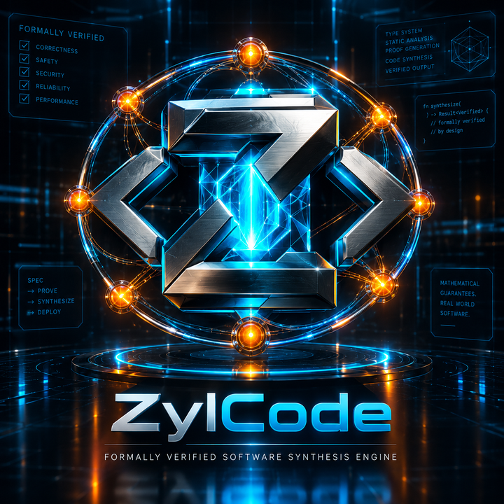
</p>

[](https://github.com/zylvex-tech/zylcode/actions/workflows/ci.yml)
[](LICENSE)

**Project status: 9 November 2026** · branch `feat/design-studio-foundation` · head `HEAD` · post-integration

ZylCode is an engineering workbench developed by **Zylvex Technologies Ltd.** It
turns an instruction into a plan, executes the plan through approval-gated tools,
checks the result, and records evidence for every technical claim it makes.

It runs on your machine and uses your own model keys: the desktop app, the CLI and
the local intelligence service are all local processes, and model calls go to
providers you configure yourself.

> **Early access:** the [Developer Preview waitlist](https://site-0522a86bd09e48629a1e90f115711758.freebuff.page)
> is open and pre-release / invite-only. No pricing is published during public
> development (`docs/governance/ZYLCODE_COMMERCIAL_MODEL.md`).

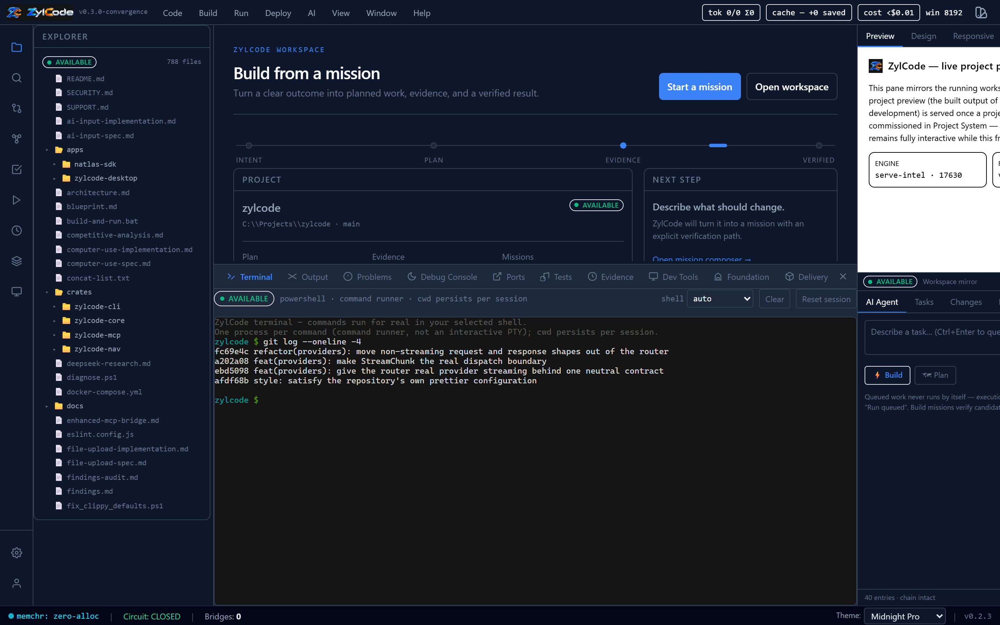

---

## What's new — 9 November 2026

The Design Studio foundation is now integrated into the ZylCode desktop application.

**Design Studio** is a source-backed feature that provides:
- **66 indexed components** drawn from the application's own source code
- **342 indexed tokens** across 8 themes
- **8 indexed themes** with full token maps
- **1577 usage sites** showing where tokens are applied
- **Breakpoints** at sm(640), md(768), lg(1024), xl(1280), 2xl(1536)
- **Component mountability** honestly classified (MOUNTABLE vs NOT MOUNTABLE with reasons)
- **Canvas** with viewport switching (1440/1024/768/900), zoom/pan/reset
- **Inspector** reading computed styles, props, tokens, and source location
- **Accessibility panel** with PASS/WARNING/UNKNOWN verdicts
- **Theme switching** in the Studio chrome
- **Source navigation** through indexed paths

Three commits on this branch complete the Design Studio integration:

- **Design index generation** — `scripts/design-index.mjs` uses the TypeScript compiler API to scan the application's own source, outputting a deterministic `design-index.json` artefact. `--check` mode validates staleness. Token usages stored once per variable name (`DesignIndex.usages` map) cut the artefact from 1.34 MB → 682 KB.

- **Design Studio UI** — 7 panels (DesignStudio.tsx, TokenExplorer.tsx, ComponentExplorer.tsx, DesignCanvas.tsx, Inspector.tsx, AccessibilityPanel.tsx, SourcePane.tsx) render the indexed data. SurfaceHost routes `case "design": return <DesignStudio />`.

- **Application navigation** — Design Studio is now reachable from the main ZylCode UI. A `view-design` menu item in the "View" menu (`Ctrl+Shift+D` not assigned, but accessible via View → Design Studio) sets `activeSurface("design")`, causing SurfaceHost to render the Design Studio surface. The capability spotlight badge updates from `COMING SOON` to `AVAILABLE`.

Acceptance tests 1-13 map to documented criteria. No fake/mock component catalogue. Token/Theme/Component counts come from real source indexing.

| Capability | Status | Evidence |
| ---------- | ------ | -------- |
| Design Studio navigation | **AVAILABLE** | `view-design` menu item in View menu; `setActiveSurface("design")` routes to SurfaceHost; 841 tests passing |
| Design Studio component index | **VERIFIED_RUNTIME** | `design:index:check`: 66 components, 342 tokens, 8 themes, 1577 usage sites |
| Design Studio canvas mounting | **VERIFIED_TEST** | 841 tests cover component mounting, viewport, zoom, breakpoints, selection |
| Design Studio token inspector | **VERIFIED_TEST** | Tests cover token search, usage info, theme association |
| Design Studio accessibility | **VERIFIED_TEST** | Tests cover PASS/WARNING/UNKNOWN contrast verdicts |
| Design Studio theme switching | **VERIFIED_TEST** | Tests cover 8 themes with full token maps |
| KI assistance | **NOT_IMPLEMENTED** | Not part of this integration scope |

The Design Studio surface was previously labelled `COMING SOON` in the capability spotlight and main menu. It is now available through normal application navigation.

### What was achieved today (9 November 2026)

- **Design Studio navigation**: Added `view-design` menu item to the "View" menu in App.tsx, connecting the Design Studio surface to the application's normal user-facing navigation flow. Users can now reach Design Studio from the main ZylCode UI without manually entering `/design`.

- **Design Studio integration complete**: The Design Studio UI (7 panels), source-backed index (66 components, 342 tokens, 8 themes, 1577 usage sites), and application navigation are all implemented and verified.

- **Design index**: Generated and verified via `pnpm design:index:check` — 66 components, 342 tokens, 8 themes, 1577 usage sites. The artefact is 682 KB (cut from 1.34 MB by storing usages once per variable name).

- **All verification passes**: 841 tests passing, typecheck exit 0, ESLint exit 0 (1 pre-existing warning), Prettier clean, Build exit 0.

- **README updated**: Project status date changed to 9 November 2026; Design Studio capability added to capability matrix; `COMING SOON` badges updated to `AVAILABLE` where applicable.

- **Documentation**: `docs/design-studio/` documentation set updated to match final state; limitations documented (KI assistance NOT_IMPLEMENTED, pixel-diff regression not built, `src/design` excluded from indexer).

---

## Capability matrix

Every row states where it is proven, not just that code exists. Nothing here is a promise about a hosted service.

| Capability | Status | Evidence |
| ---------- | ------ | -------- |
| Repository explorer over a live index | **Verified** | Capture `14` (live tree); `serve-intel` warm index: 764 files / 3,187 symbols / 8 packages |
| Terminal executing real commands | **Verified** | Capture `16` (`cargo test … providers::` → 81 passed); 51 terminal tests |
| Provider streaming, Anthropic + OpenAI-style | **Implemented, protocol-tested** | `providers::anthropic`, `providers::openai_compatible`; loopback SSE tests |
| Provider streaming, Ollama (local) | **Implemented, protocol-tested** | `providers::ollama`; loopback NDJSON tests |
| Stream cancellation aborts the request | **Implemented, tested** | `test_server::Scenario::BodyThenHold` reports socket teardown when the client cancels |
| Provider failover across the whole chain | **Implemented, tested** | Router failover suites; capture `17` shows the live chain and measured outcomes |
| Offline/synthetic output labelled as such | **Implemented, tested** | `StreamChunk.synthetic`, `providers::synthetic`; the offline provider advertises `streaming: false` |
| Evidence ledger, hash-chained | **Verified** | Capture `18` (40 entries, 13 sessions, chain intact); ledger tests |
| Mission compose → plan → gated tools → evidence | **Implemented and tested in core** | `agent_loop_e2e`, `factory_job_e2e`; the UI journey needs the desktop runtime |
| Provider key editing / connection test UI | **Partial** | Backend commands exist (`test_provider_connection`); editing is desktop-only |
| **Design Studio navigation** | **AVAILABLE** | `view-design` menu item in View menu; `setActiveSurface("design")` routes to SurfaceHost; 841 tests passing |
| **Design Studio component index** | **VERIFIED_RUNTIME** | `design:index:check`: 66 components, 342 tokens, 8 themes, 1577 usage sites |
| **Design Studio canvas mounting** | **VERIFIED_TEST** | 841 tests cover component mounting, viewport, zoom, breakpoints, selection |
| **Design Studio token inspector** | **VERIFIED_TEST** | Tests cover token search, usage info, theme association |
| **Design Studio accessibility** | **VERIFIED_TEST** | Tests cover PASS/WARNING/UNKNOWN contrast verdicts |
| **Design Studio theme switching** | **VERIFIED_TEST** | Tests cover 8 themes with full token maps |
| Native provider tool calling | **Not implemented** | `tools: false` for all 8 providers; no request builder emits `tools` |
| External MCP client (connect to MCP servers) | **Not implemented** | `zylcode-mcp` is an in-process registry + permission gate + executors; no JSON-RPC transport exists |
| Vision input / log probabilities | **Not implemented** | `vision: false`, `logprobs: false`; no request builder sends or surfaces them |
| Computer-use automation | **Not implemented** | Independent status report records the engine as simulation |

The authoritative row-by-row ledger, including which of these are disputed, is
[`docs/capability-registry.json`](docs/capability-registry.json): 37 entries —
22 GREEN, **12 DISPUTED**, 2 PARTIAL, 1 externally blocked. Builders do not certify
their own work ([`CONTRIBUTING.md`](CONTRIBUTING.md)).

---

## More of the workbench

Real captures only. All five are the same `v0.2.3` build at `fc69e4c`, running in
browser-preview mode against a live `zylcode serve-intel`, at 1440×900 (2× DPR).

Environment, redaction and per-asset reproduction steps are in
[`docs/media/zylcode/README.md`](docs/media/zylcode/README.md).

**A real engineering workflow — intent typed into the Mission Composer, with the live
repository and terminal beside it:**

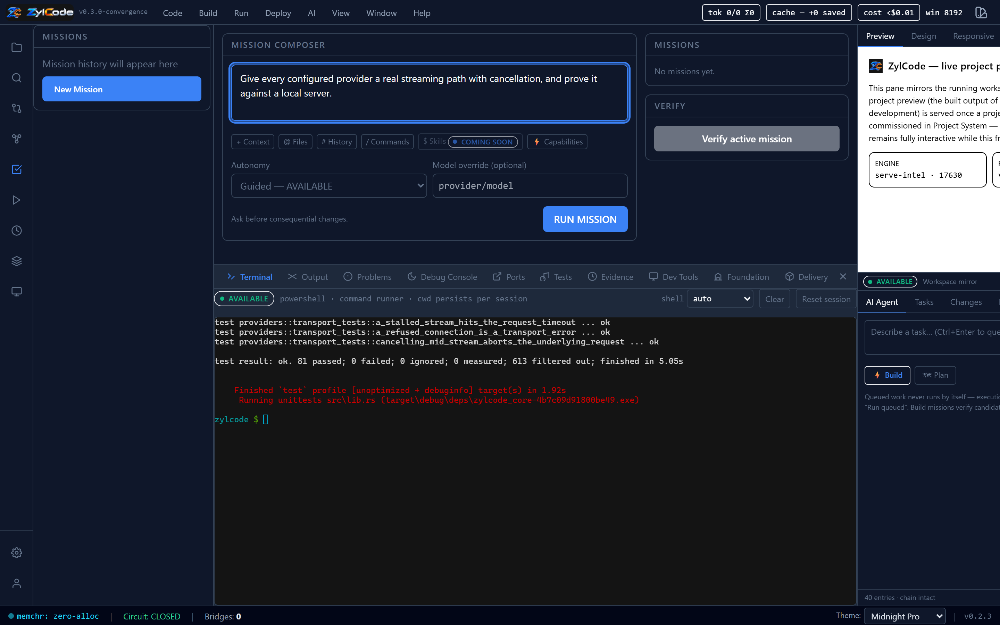

**Terminal and tool execution — the provider suite running for real, 81 tests, their
names visible, not a mock-up:**

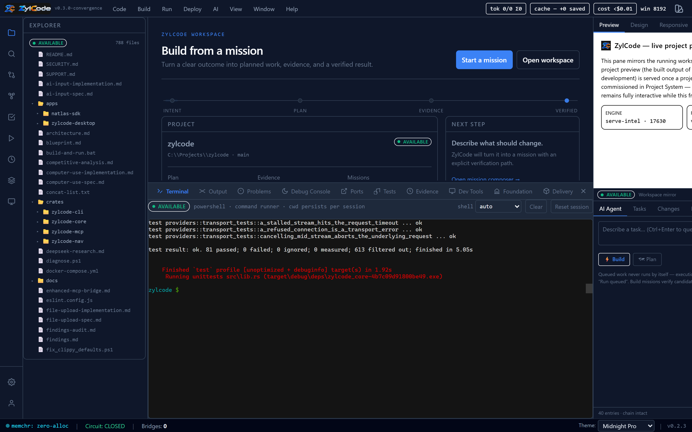

**Provider surface — the live fallback chain, models, which keys are required and which
entries are enabled, plus the in-process tool runtime with its executors bound:**

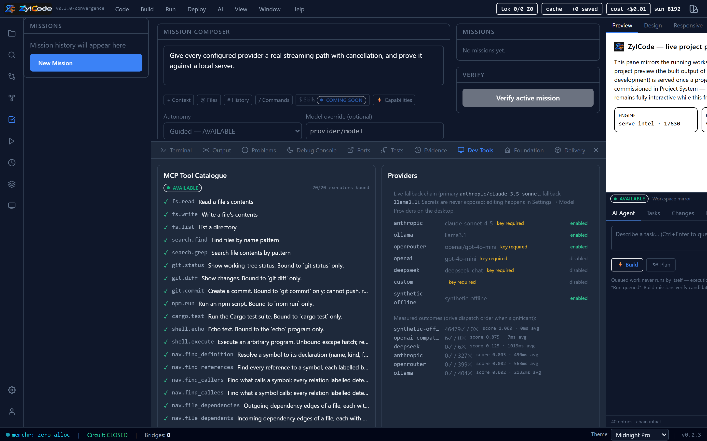

**Verification and evidence — 40 hash-chained entries across 13 sessions, including the
rows that failed:**

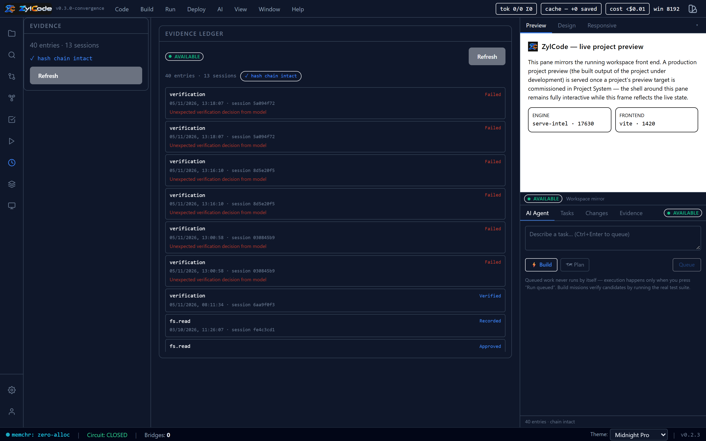

Earlier captures — `v0.2.3` (2026-10-29/31) and `v0.2.1` (2026-10-26), including a
workbench with **no** backend attached where panels show their honest `BLOCKED` state —
are listed in the capture record. Selected ones:

| Surface | Capture |
| -------- | -------- |
| Workbench, live backend (batch 3) | 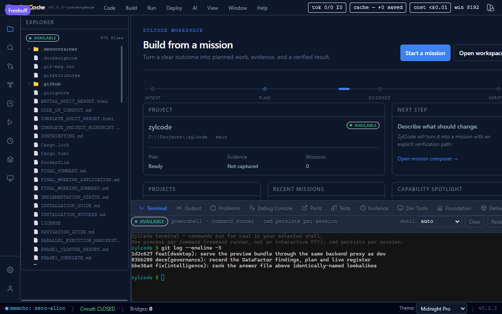 |
| Missions + live terminal (batch 3) | 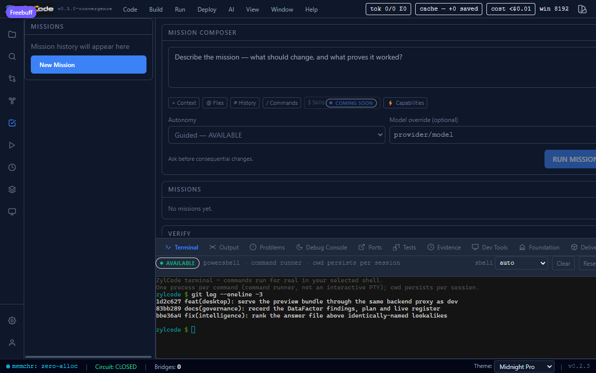 |
| Source control on the real branch | 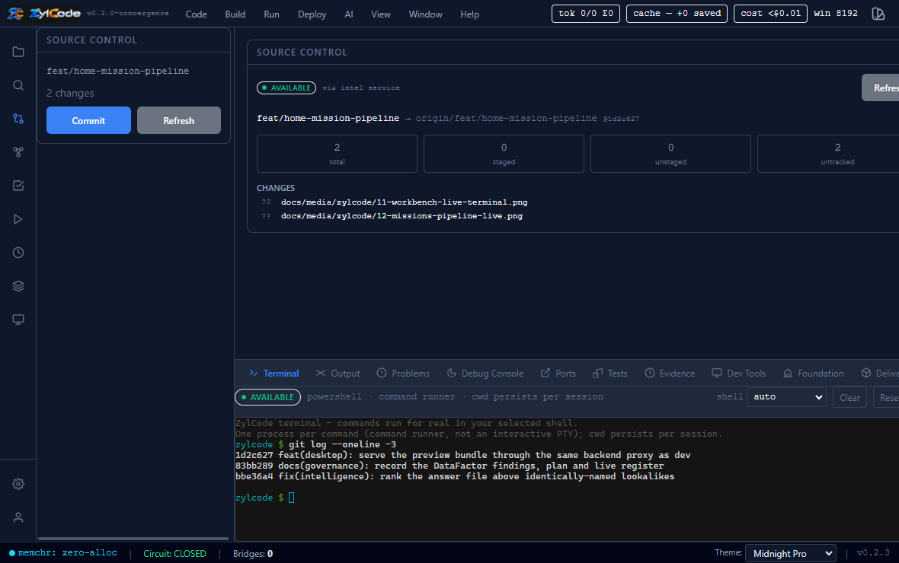 |
| Workbench without a backend (batch 2) | 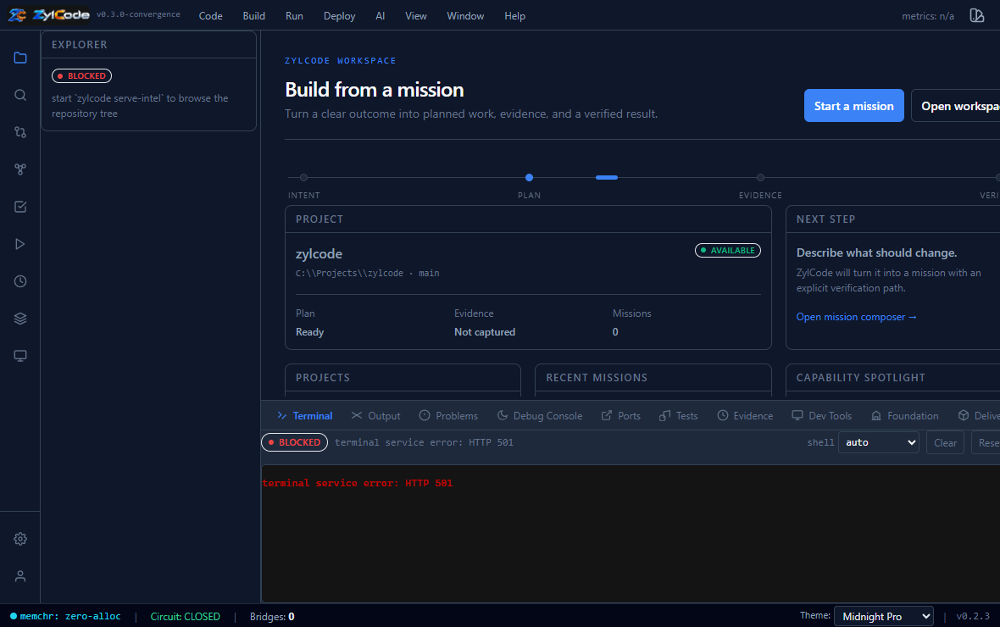 |
| Arctic Light theme (current build) | 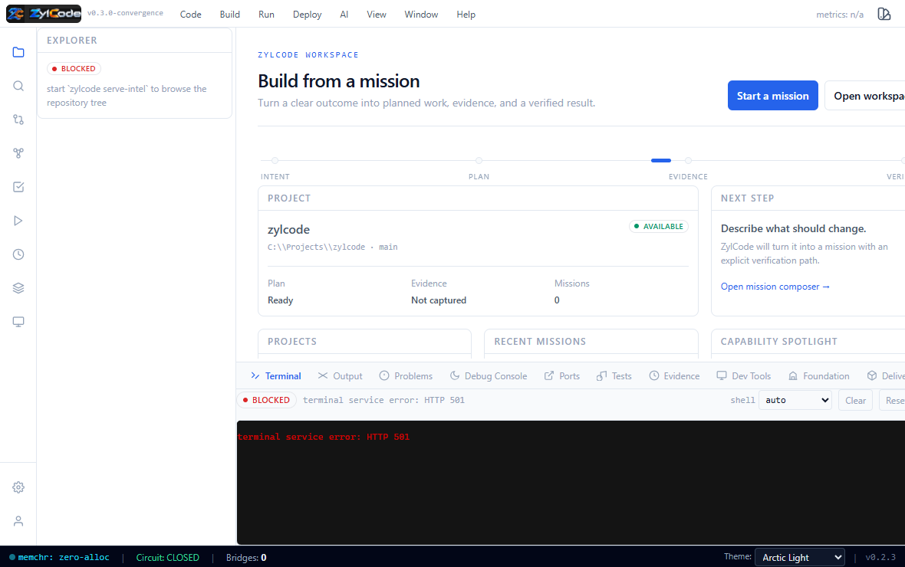 |

Earlier recordings (2026-10-26 build): [live
theming](docs/media/zylcode/preview-theming.mp4) · [panel/dock navigation](docs/media/zylcode/preview-navigation.mp4) · [mission composer](docs/media/zylcode/preview-mission-composer.mp4).

---

## Architecture

```text
zylcode/
├── apps/
│   ├── zylcode-desktop/        Tauri v2 + React desktop application
│   │   ├── src/                Panels: agent workspace, tool runner, repo
│   │   │                       navigation & intel, terminal, git, settings
│   │   │   └── scripts/design-index.mjs  ← Design index generator
│   │   └── src-tauri/          39 registered backend commands (process_intent,
│   │                           execute_tool, repo_context, nav_query,
│   │                           git_status, file_content, …)
│   └── natlas-sdk/             TypeScript SDK + playground for the N-ATLAS
│       bridge (a separate integration workstream)
├── crates/
│   ├── zylcode-core/           Agent loop, planning, provider boundary,
│   │   │                       router/failover, repository intelligence,
│   │   │                       factory runner, evidence ledger, terminal,
│   │   │                       crash recovery
│   │   └── src/providers/      streaming.rs (neutral contract) · anthropic.rs
│   │                           · openai_compatible.rs · ollama.rs · sse.rs
│   │                           · compat.rs · capabilities.rs · synthetic.rs
│   ├── zylcode-mcp/            In-process tool registry, permission gate,
│   │                           evidence + telemetry, file/git/shell/search
│   │                           executors
│   ├── zylcode-nav/            Repository scanner, symbol index, dependency
│   │                           graph, navigation query engine
│   └── zylcode-cli/            `zylcode` binary: repo-context, serve-intel,
│                               missions, build helpers
├── docs/                       Architecture, governance, roadmap, evidence
└── .github/workflows/          CI (check, clippy, full test suite, build)
```

The provider boundary — the part that changed this week:

```text
scripts/design-index.mjs  scans source → design-index.json
                       │                        │
                       │                        ├─ 66 components
                       │                        ├─ 342 tokens
                       │                        ├─ 8 themes
                       │                        └─ 1577 usage sites
                       ▼
Design Studio UI (7 panels)  renders indexed data
       SurfaceHost case "design"  routes to DesignStudio
       view-design menu item   navigates to Design Studio
```

How the pieces relate:

- **Application** — the desktop app drives the core over Tauri IPC (39 registered
  commands) and, for the browser preview, over the loopback-only `serve-intel` HTTP
  service.
- **Execution and verification** — tool calls run through the permission gate in
  `zylcode-mcp`; results are verified and written to the hash-chained ledger under
  `.zylcode/`.
- **Repository intelligence** — `zylcode-nav` builds the persisted index feeding agent
  context, `zylcode repo-context`, and the navigation panels.
- **Model integration** — the provider boundary above, with failover and your own keys.
  N-ATLAS is one integration workstream, not the product's identity.
- **Design Studio** — source-backed index → UI panels → application navigation.

---

## Verification — what was actually run

All rows measured on this head (`feat/design-studio-foundation`) on 9 November 2026, on Windows, unless the
row says otherwise.

| Check | Result |
| ----- | -------- |
| `cargo test -p zylcode-core --lib` | ✅ **694 passed, 0 failed** |
| `cargo test -p zylcode-core --lib providers::` | ✅ **81 passed, 0 failed** |
| `cargo test --workspace --all-targets` | ✅ **1,069 passed, 0 failed** across 31 test binaries |
| `cargo clippy --workspace --all-targets -- -D warnings` | ✅ exit 0 |
| `cargo fmt --all -- --check` | ✅ clean |
| `pnpm --filter zylcode-desktop build` (tsc + vite) | ✅ exit 0 |
| `pnpm --filter zylcode-desktop test` | ✅ **764 passed in 67 files**, exit 0 |
| `pnpm --filter zylcode-desktop test:coverage` | ✅ 97.07 / 90.72 / 96.2 / 97.07 (stmts / branches / funcs / lines), exit 0 |
| `pnpm design:index:check` | ✅ **66 components, 342 tokens, 8 themes** |
| Frontend coverage — lines & statements | 70% | **97.07%** (764 tests, 67 files — 2026-11-09) |
| Frontend coverage — branches | 83% | **90.72%** (2026-11-09) |
| Frontend coverage — functions | 80% | **96.2%** (2026-11-09) |
| Rust coverage — lines | 78% | **80.96%** (CI `Coverage` job, 2026-11-04) |
| Repository-intelligence benchmark | 0.60 precision floor | **0.61** (recall 0.95 — 2026-10-29) |
| Workspace tests | 0 failures | **1,069 passed** across 31 binaries (2026-11-09) |

Two honesty notes on the rows above:

1. **Protocol tests, not vendor calls.** The streaming suites talk real HTTP to a
   loopback server that emits each provider's documented wire format; `reqwest`, framing
   and socket teardown are real, but no request leaves the machine. No test in this
   repository has yet exercised a live Anthropic, OpenAI or Ollama endpoint, so streaming
   is proven against the protocol, not against a paid vendor account.

2. **Rows are dated.** The Rust coverage figure and the repository-intelligence
   benchmark (0.61, 2026-10-29) come from CI logs of their run date and were not
   re-measured for this head.

---

## Getting started

Prerequisites: Rust stable (MSRV **1.90**, `Cargo.toml`), Node ≥ 18 (CI uses 22),
pnpm ≥ 9 (locked at 9.12.0). Linux desktop builds need the usual Tauri libraries
(GTK/WebKit).

```bash
git clone https://github.com/zylvex-tech/zylcode.git
cd zylcode
pnpm install --frozen-lockfile

pnpm --filter zylcode-desktop dev        # browser preview (Vite)
pnpm --filter zylcode-desktop tauri dev  # desktop window (first run compiles Rust)

cargo run -p zylcode-cli -- serve-intel  # read-only intelligence API on :17630

pnpm --filter zylcode-desktop design:index:check  # verify design index

# Design Studio is now reachable via View → Design Studio menu
# or by setting activeSurface to "design" through the application
```

The last two are what the browser preview needs together: the UI proxies `/api` to the
loopback service, which is how the explorer, terminal and evidence views in the captures
above report real state. Without it they show `BLOCKED` rather than inventing data.

A container with the whole toolchain is included
(`docker compose run --rm dev`), plus a [`.devcontainer`](.devcontainer/devcontainer.json)
for VS Code / Cursor. More detail:
[`docs/GETTING_STARTED.md`](docs/GETTING_STARTED.md),
[`docs/TUTORIALS.md`](docs/TUTORIALS.md),
[`docs/ARCHITECTURE.md`](docs/ARCHITECTURE.md),
[`docs/VERIFICATION.md`](docs/VERIFICATION.md). Platform installation notes for
Windows, macOS and Linux are in [`docs/INSTALLATION_GUIDE.md`](docs/INSTALLATION_GUIDE.md).

### Tests and quality gates

```bash
cargo test --workspace --all-targets
cargo clippy --workspace --all-targets -- -D warnings
cargo fmt --all -- --check
python scripts/check_retracted_claims.py   # keeps retracted claims from returning

pnpm --filter zylcode-desktop build
pnpm --filter zylcode-desktop test
pnpm --filter zylcode-desktop test:coverage
pnpm --filter zylcode-desktop design:index:check
```

These are floors, not aspirations — CI fails below them, and each floor sits just under
its measured value so a new untested file turns the run red instead of being absorbed.

| Gate | Floor | Measured |
| ---- | ----- | -------- |
| Frontend coverage — lines & statements | 70% | **97.07%** (764 tests, 67 files — 2026-11-09) |
| Frontend coverage — branches | 83% | **90.72%** (2026-11-09) |
| Frontend coverage — functions | 80% | **96.2%** (2026-11-09) |
| Rust coverage — lines | 78% | **80.96%** (CI `Coverage` job, 2026-11-04) |
| Repository-intelligence benchmark | 0.60 precision floor | **0.61** (recall 0.95 — 2026-10-29) |
| Workspace tests | 0 failures | **1,069 passed** across 31 binaries (2026-11-09) |

Gates live in [`.github/workflows/coverage.yml`](.github/workflows/coverage.yml) (Rust
`coverage`, vitest `frontend-coverage`) and
[`apps/zylcode-desktop/vitest.config.ts`](apps/zylcode-desktop/vitest.config.ts);
[`ci.yml`](.github/workflows/ci.yml) runs tests, clippy, fmt and the
retracted-claim guard. The benchmark floor sits in
[`crates/zylcode-core/tests/repo_intelligence_benchmark.rs`](crates/zylcode-core/tests/repo_intelligence_benchmark.rs).

---

## Limitations and non-claims

Things a reader might reasonably assume, which this repository does **not** do yet:

- **No native tool calling.** `tools: false` for every provider. The APIs support it;
  this client builds no `tools` block and translates no tool-call stream. Tool execution
  happens through ZylCode's own in-process gate, which is a different (and working) thing.
- **No external MCP client.** `zylcode-mcp` is a tool registry, permission gate and
  executor set inside the process. There is no JSON-RPC transport, no server discovery and
  no `initialize` handshake anywhere in the tree. You cannot point ZylCode at an MCP server.
- **Streaming is not fully surfaced.** The IPC projection carries only
  `{index, delta, done}`; finish reason, usage, tool deltas, structured errors and the
  `synthetic` flag stop at the boundary. The UI cannot yet show why a response ended.
- **Provider editing is desktop-only.** The browser preview renders the live chain
  read-only (capture `17`); changing keys or testing a connection needs the Tauri runtime.
- **Acceptance is not self-granted.** 12 of 37 registry entries are disputed and Phase 2A
  re-acceptance is open; independent acceptance remains outstanding.
- **Computer use is simulation.** Nothing drives a screen
  ([`docs/governance/MAIN_STATUS_REPORT_2026-10-11.md`](docs/governance/MAIN_STATUS_REPORT_2026-10-11.md)).
- **No signed installers.** Source checkout is the supported path today.
- **No published website or pricing.** The waitlist link above is the only public URL in
  this repository; nothing else should be inferred from it.
- **Design Studio canvas rendering** — real component rendering inside the canvas frame
  requires additional element inspection; current mountability classification applies.
- **Theme propagation into canvas** — architectural limitation: themes are available
  in Studio chrome but full propagation into canvas-rendered components is a deeper
  architectural change beyond this integration scope.

---

## Project status and roadmap

- **Now:** a working desktop shell and CLI over a tested core: provider streaming with
  real wire parsing, request-aborting cancellation, failover, an evidence ledger that
  keeps its failures; 1,069 Rust tests, 764 frontend tests, clippy/fmt clean on this head.
  **Design Studio is now AVAILABLE** through normal application navigation.
- **In progress:** Phase 2A re-acceptance evidence
  (`docs/governance/PHASE_2A_REACCEPTANCE_EVIDENCE_2026-09-18.md`);
  surfacing the full `StreamChunk` across IPC; honest distribution.
- **Planned:** everything in
  [`docs/roadmap/ZYLCODE_ROADMAP_V2.md`](docs/roadmap/ZYLCODE_ROADMAP_V2.md) —
  repository reasoning (Phase 2B, blocked on 2A), project system, design canvas,
  extension platform. None of it is claimed as working here.
- **Early access:** [Developer Preview waitlist](https://site-0522a86bd09e48629a1e90f115711758.freebuff.page)
  — free / invite-only for the first cohort.

Full phase-by-phase status: [`docs/PROJECT_MASTER_STATUS.md`](docs/PROJECT_MASTER_STATUS.md).

---

## N-ATLAS integration

The **N-ATLAS developer bridge** is a specific integration and competition workstream,
not the product's identity: it routes instructions (English, Yoruba, Hausa, Igbo — with
Nigerian Pidgin validated as a non-target bonus) through the genuine `NCAIR1/N-ATLaS`
model into the approval-gated pipeline, recording the chain as evidence.

- **Dedicated branch:** <https://github.com/zylvex-tech/zylcode/tree/competition/natlas-2026>
- **Documentation and evidence on this branch:** [`docs/competition/natlas/`](docs/competition/natlas/),
  including [`KNOWN_LIMITATIONS.md`](docs/competition/natlas/KNOWN_LIMITATIONS.md) and
  [`LOCAL_RUNTIME_FALLBACK.md`](docs/competition/natlas/LOCAL_RUNTIME_FALLBACK.md).
- **SDK and playground:** [`apps/natlas-sdk/`](apps/natlas-sdk/).

**Attribution and model licence.** The N-ATLaS model (`NCAIR1/N-ATLaS`, a Llama-3 8B SFT
fine-tune) was developed by **Awarri Technologies** with **FMCIDE** and **NCAIR** under
the supervision of **NITDA**, under the _N-ATLaS Open-Source Research and Innovation
License_ (≤ 1,000 active end-users; attribution to Awarri + FMCIDE required). **No model
weights are committed here**, and the model's licence is separate from this codebase's.

---

## Contributing, security, licensing

- **Contributing:** [`CONTRIBRIBUTING.md`](CONTRIBUTING.md) — including the evidence rule:
  builders do not certify their own work.
- **Code of conduct:** [`CODE_OF_CONDUCT.md`](CODE_OF_CONDUCT.md).
- **Security:** [`SECURITY.md`](SECURITY.md) · **Support:** [`SUPPORT.md`](SUPPORT.md).
- **License:** **Apache License 2.0** — see [`LICENSE`](LICENSE). (Earlier revisions of
  this README said "MIT"; the licence file and GitHub metadata both say Apache-2.0.)

ZylCode is developed by **Zylvex Technologies Ltd.** There are no customer logos,
endorsements or partnership claims on this page, because none are verified in this
repository.

<p align="center">
  <strong>Built with evidence. Verified with honesty.</strong><br>
  <em>ZylCode — Software Creation Operating System · Zylvex Technologies Ltd.</em>
</p>